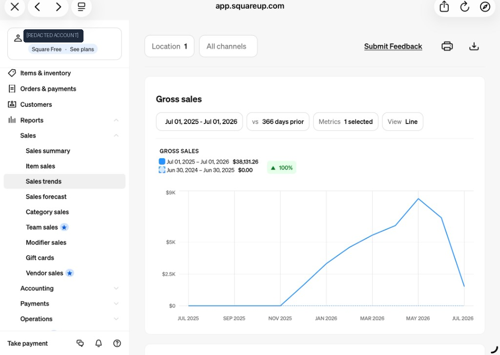
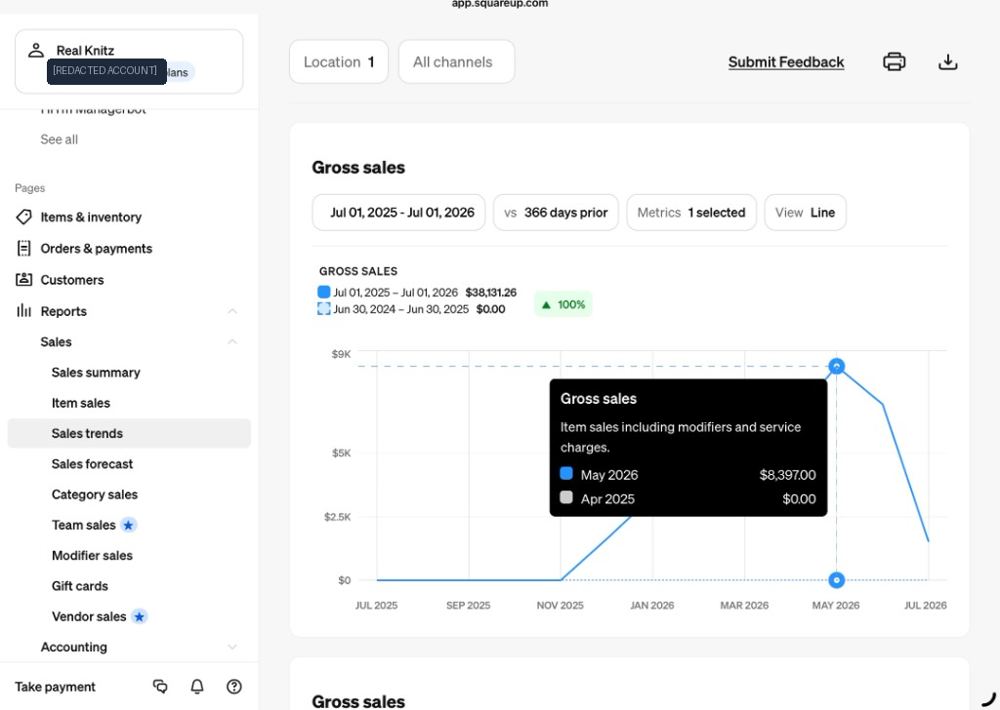
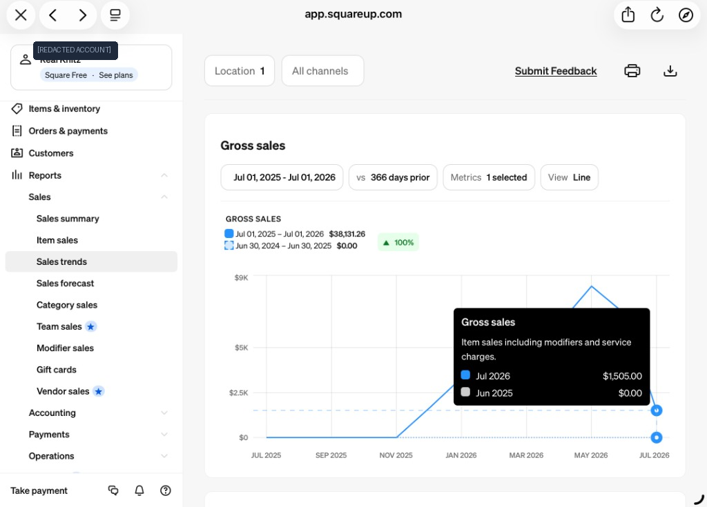

# Screenshot Evidence Analysis
**Brand:** Frogeindrip (DTC Apparel)  
**Platform:** Square POS / Square Analytics (`app.squareup.com`)  
**Auditor:** Senior Data Analyst & Privacy Lead  

---

## 1. Overview of Raw Visual Evidence

Visual evidence artifacts have been extracted directly from the client's Square Analytics administrative console, sanitized for client confidentiality, and cataloged in [`evidence/screenshots/`](file:///Users/sahit/Frogein%20drip/evidence/screenshots/):

```
evidence/screenshots/
       │
       ├── 01_square_gross_sales_trend_overview.png   (Gross Sales: $38,131.26 | Jul 01, 2025 - Jul 01, 2026)
       ├── 02_square_may_2026_peak_sales_tooltip.png  (Peak Month: $8,397.00 | May 2026)
       └── 03_square_july_2026_run_rate_tooltip.png   (Post-Peak Run-rate: $1,505.00 | Jul 2026)
```

---

## 2. In-Depth Screenshot Inspection

### Screenshot 1: Sales Trends High-Level Overview


- **URL Path:** `app.squareup.com/dashboard/reports/sales/trends`
- **Account Identifier:** `[REDACTED ACCOUNT]` *(Internal Square profile identifier; brand is Frogeindrip)*
- **Service Plan:** `Square Free · See plans`
- **Location Filter:** `Location 1`
- **Channel Filter:** `All channels`
- **Selected Metric:** `Gross sales`
- **Active Reporting Window:** `Jul 01, 2025 – Jul 01, 2026` (366 days)
- **Comparison Window:** `Jun 30, 2024 – Jun 30, 2025`
- **Reported Gross Sales:** **$38,131.26**
- **Comparison Period Gross Sales:** **$0.00**
- **Visual Growth Badge:** `▲ 100%` (light green pill)
- **Trajectory Curve:**
  - Flat $0 line from July 2025 until late October / November 2025 (indicating pre-launch phase).
  - Inflection upward starting November 2025 ($0 -> ~$1.2k).
  - Steady expansion through January 2026 (~$3.5k), March 2026 (~$5.8k), reaching a maximum peak in May 2026.
  - Steep downward slope into June/July 2026 as inventory sold through or marketing paused.

---

### Screenshot 2: Peak Month Deep-Dive


- **Active Tooltip:** Focused on May 2026 datapoint on line chart.
- **Metric Definition Displayed:** *"Item sales including modifiers and service charges."*
- **Reported May 2026 Volume:** **$8,397.00**
- **Comparison Volume (Apr 2025):** **$0.00**
- **Business Significance:** May 2026 accounts for **22.02%** of the entire 12-month rolling gross revenue ($8,397 / $38,131.26), confirming a high-velocity seasonal or capsule collection apparel drop.

---

### Screenshot 3: Post-Peak Drop-off Deep-Dive


- **Active Tooltip:** Focused on July 2026 datapoint on line chart.
- **Reported July 2026 Volume:** **$1,505.00**
- **Comparison Volume (Jun 2025):** **$0.00**
- **Business Significance:** Confirms contraction post-launch. Reflects stock depletion and markdown phase after peak campaign.

---

## 3. Screenshot Group A Reference (Sales Summary)
*(From accompanying primary reporting records provided in project brief)*
- **Net Sales:** **$46,271.26**
- **Date Range:** `Sep 01, 2025 – Jul 31, 2026` (11 calendar months)
- **Granularity:** Hourly, daily, and day-of-week aggregations.
- **Key Variance with Group B:**
  - Different start date (Sep 2025 vs. Jul 2025) and end date (Jul 31, 2026 vs. Jul 01, 2026).
  - Captures full month of July 2026.
  - Reports **Net Sales** (gross minus refunds/discounts) over an extra month of active trading, resulting in $46,271.26 vs $38,131.26.

---

## 4. Privacy, Security, and Compliance Rules

1. **Account Redaction:** The name "Real Knitz" appears on the Square dashboard navigation header. In all portfolio markdown, dashboard UIs, and presentation decks, this name is redacted or labeled as `[REDACTED ACCOUNT ID]` to preserve privacy.
2. **Confidentiality:** No customer identities, credit card tokens, or internal Square merchant tokens are exposed.
3. **No Synthetic Misrepresentation:** Synthetic datasets generated for data engineering and ML modeling are explicitly identified as simulated benchmarks to avoid confusing recruiters or stakeholders.
